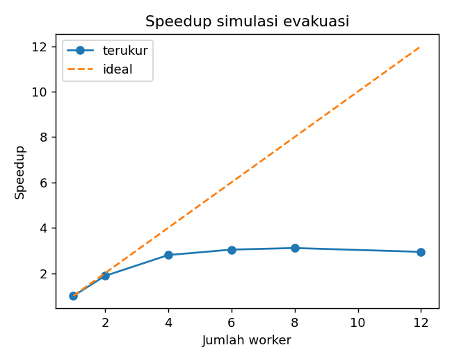

# Bridging Local Challenges to HPC: Parallel Monte Carlo Evacuation Simulation

Case study for the _Informatics Practitioner Lecture Series_ session
"Bridging Global Infrastructure to Address Local Challenge with HPC" (Universitas Bengkulu).

## Local problem

Bengkulu is exposed to earthquake/tsunami risk. Planners need to know **what share of residents can reach shelters within a time limit**
under different warning delays and shelter distances. One run is cheap, but exploring many scenarios with uncertainty (Monte Carlo) is not.

## The "Integrator" workflow (from the lecture)

1. **Define the local problem** -> evacuation-time uncertainty.
2. **Write the processing script** -> `src/simulate.py` (one independent task per scenario).
3. **Parallelize** -> `src/benchmark.py` (multiprocessing, 1..N workers).
4. **Run as batch job** -> `job.slurm` (SLURM template; adjust modules/partition per cluster).
5. **Move data/results** -> over SSH/`scp`/`rsync`; results are plain CSV/PNG.
6. **Deliver** -> `results/` feeds a report or dashboard (cloud deploy = future work).

## Run

```bash
pip install -r requirements.txt
python -m src.benchmark                 # default: workers 1, 2, 4, #cores
python -m src.benchmark --workers 1 2 4 6 8 12   # command used for the results below
sbatch job.slurm                        # on a SLURM cluster
```

Outputs: `results/benchmark.csv`, `results/speedup.png`, `results/scenarios.csv`.

## Results

Measured on a local Windows machine, 240 independent scenarios per setting.
Two runs were made; the table shows the second one (wider worker range). `results/` contains the outputs of this second run.

| Workers | Time (s) | Speedup | Efficiency |
| ------- | -------- | ------- | ---------- |
| 1       | 30.87    | 1.00    | 1.00       |
| 2       | 16.40    | 1.88    | 0.94       |
| 4       | 11.01    | 2.80    | 0.70       |
| 6       | 10.15    | 3.04    | 0.51       |
| 8       | 9.92     | 3.11    | 0.39       |
| 12      | 10.49    | 2.94    | 0.24       |



Speedup rises quickly up to 4 workers and then plateaus at about 3x from 6 to 12 workers, while efficiency falls steadily.
Solving Amdahl's law for the non-parallel fraction f at each setting gives roughly 0.06 (2 workers), 0.14 (4), 0.19 (6), 0.22 (8) and 0.28 (12).
Because f is not constant, a single serial fraction does not explain the curve; overhead and resource contention appear to grow with the number of workers.
The exact cause (physical core count, memory bandwidth, process start-up cost on Windows) was not measured.

In an earlier run (workers 1, 2, 4, 12) the 12-worker setting took 23.56 s (speedup 1.39), slower than 4 workers.
This was not reproduced in the second run, so it is treated as a noisy measurement, possibly caused by other load on the machine (not verified).
Each setting was run once per session, so timings are noisy.

## Honest limitations

- **Model parameters (speed, delay, congestion, 20-minute limit) are illustrative assumptions, not calibrated to real Bengkulu data.** Do not interpret `share_safe` as a real risk estimate.
- This is a single-machine benchmark; the SLURM script was **not tested on a real HPC cluster**.
- The task is embarrassingly parallel, so it scales better than most real workloads.
- Timings come from single runs on a laptop, so small differences between worker counts are not meaningful.
- A real study would use official evacuation routes/shelter capacity (e.g. BPBD/BMKG) and spatial agent-based models.
